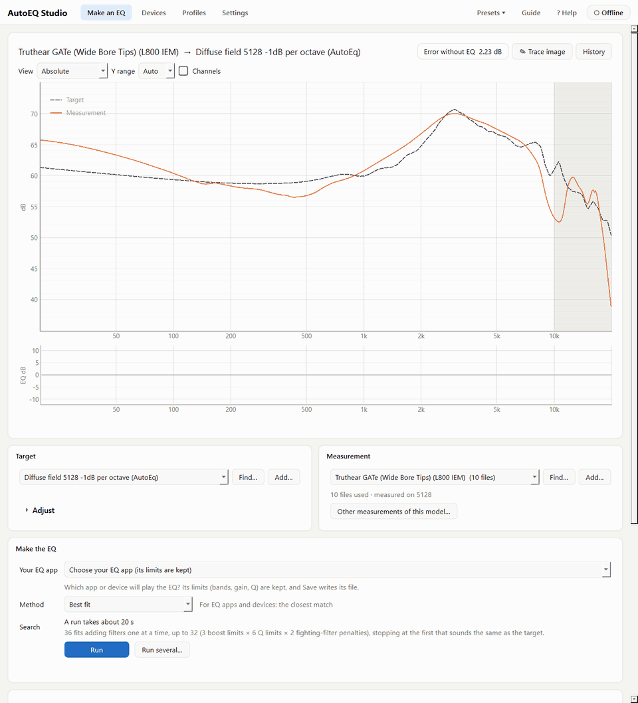
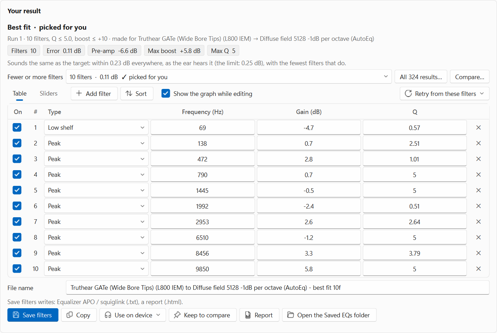
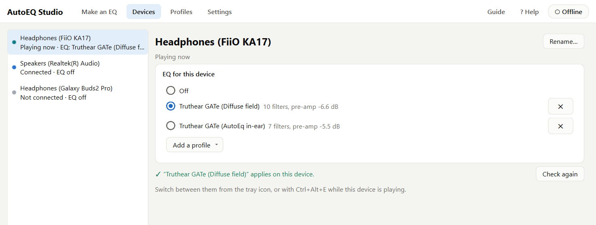

# AutoEQ Studio

A Windows app that makes EQs for headphones and IEMs, and gives each playback device on your PC its own EQ.

- **Make an EQ.** Compares a measurement of your headphones or IEMs with a target curve (the sound you want) and
  finds the filters that make one match the other. It saves them as the file your EQ app needs, or puts them
  straight onto a device.
- **Per-device EQ.** Each playback device gets its own EQ, switched automatically. Plug in your earphones' dongle and
  their EQ is on; connect your Bluetooth earbuds and theirs is; your speakers can have none. This part works through
  [Equalizer APO](https://sourceforge.net/projects/equalizerapo/), which does the actual sound processing.

It's a native desktop app (Python and Qt), not a web page, and works offline.

## Features

- **Best fit:** adds filters one at a time and keeps the simplest EQ that sounds the same as the target (within
  0.25 dB everywhere, weighted as the ear hears it), within your EQ app's limits (filter count, Q, gain, frequency
  range). The AutoEQ method used by squig.link sites is built in too.
- **Measurements and targets:** use your own files, or search the online measurement databases (squig.link sites,
  AutoEq) and the files on your PC. It compares several measurements of the same model, and converts targets
  between measurement rigs (711 coupler, B&K 5128).
- **Target adjustments:** tilt, bass, treble, ear gain and more, shown live on the graph.
- **Exports for 34 EQ apps and devices**, each within its own limits: Equalizer APO, Peace, foobar2000, Roon,
  Wavelet, Poweramp, USB Audio Player PRO, Qudelix, FiiO, miniDSP, EasyEffects and more, plus an HTML report.
- **Listen:** hear the EQ through your own headphones, level-matched, with a blind test option.
- **Graph tracer:** turns a picture of a frequency-response graph (a manufacturer's sheet, a review's screenshot)
  into a measurement, reading the axes with Windows' own text reader.
- **Device switching:** profiles for each device, a tray icon, a hotkey, notices, and a check that asks Equalizer
  APO whether the EQ really plays.
- **Help built in:** a guided tour with demos, Help for every term and setting (F1 on any control), light and dark
  themes, keyboard and screen-reader support.

## Screenshots

  
  

## Requirements

- Windows 10 or 11, 64-bit
- [Equalizer APO](https://sourceforge.net/projects/equalizerapo/) for the per-device EQ (Make an EQ works without it)
- Running from source: 64-bit [Python](https://www.python.org/downloads/) 3.10 or newer

## Installing it

Download `AutoEQ Studio Setup <version>.exe` from the [latest release](https://github.com/OscarBazylewich/AutoEQ-Studio/releases/latest)
and run it. It installs for your Windows account only (no administrator password) and has its own Python inside,
so nothing else is needed. The installer isn't signed, so Windows may say "Windows protected your PC": click
More info, then Run anyway. Running a newer Setup later updates it and keeps your files and settings.

## Running it from source

1. Download this repository (Code > Download ZIP, then extract it) or clone it.
2. Double-click `AutoEQ Studio.bat`. The first start sets up its Python packages (Qt, numpy, scipy and the rest,
   about 150 MB) in a `.venv` folder; later starts open straight away.
3. Click **Guide** (top right) for a tour, or **Help** for every setting.

To use the per-device EQ, install Equalizer APO on your devices first, then click **Set up…** in the app.

**Building an installer:** `Make installer.bat` makes `releases\AutoEQ Studio Setup <version>.exe`, a normal Windows
installer with its own Python inside. It needs [Inno Setup 6](https://jrsoftware.org/isinfo.php)
(`winget install JRSoftware.InnoSetup --scope user`).

[README.txt](README.txt) is the full guide to every screen and setting.

## Your files

Your targets, measurements, saved EQs and presets go in `Documents\AutoEQ Studio` (Settings > Your files can choose
another folder). Settings and history are kept in the app's `data` folder, or in AppData when installed. Nothing of
yours is stored in this repository.

## Development

- `app\tools\selftest.py` tests every part on a fake Equalizer APO folder and a temporary copy of the app (your own
  files and settings are never touched):
  `.venv\Scripts\python.exe app\tools\selftest.py` (add `--quick` to skip the slower EQ checks).
- `app\requirements-dev.txt` adds [Ruff](https://docs.astral.sh/ruff/), the linter the self-test runs.
- Each module starts with a description of what it does.

## Credits

- [AutoEq](https://github.com/jaakkopasanen/AutoEq) by Jaakko Pasanen: the parametric EQ maths in `app/eq/vendor/autoeq`
  (MIT) and targets in `samples`.
- [squig.link](https://squig.link) and its graph tool: the AutoEQ method in `app/eq/vendor/squiglink` (0BSD) and the
  measurement databases.
- [Equalizer APO](https://sourceforge.net/projects/equalizerapo/), which applies the EQ to each device.

## License

[MIT](LICENSE). The files in `app/eq/vendor` keep their own licences, beside them.
