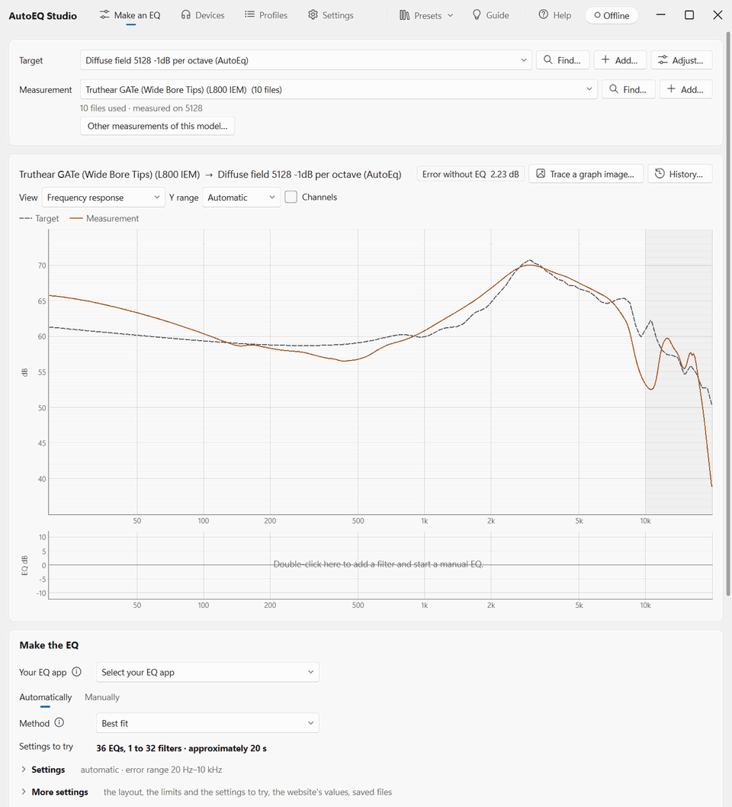
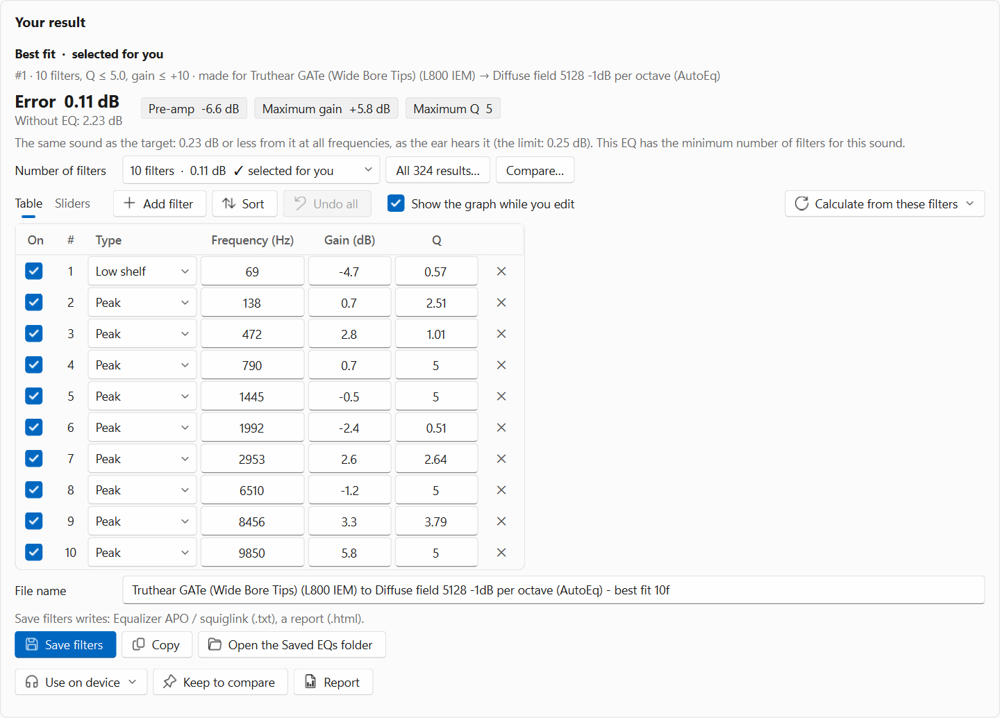
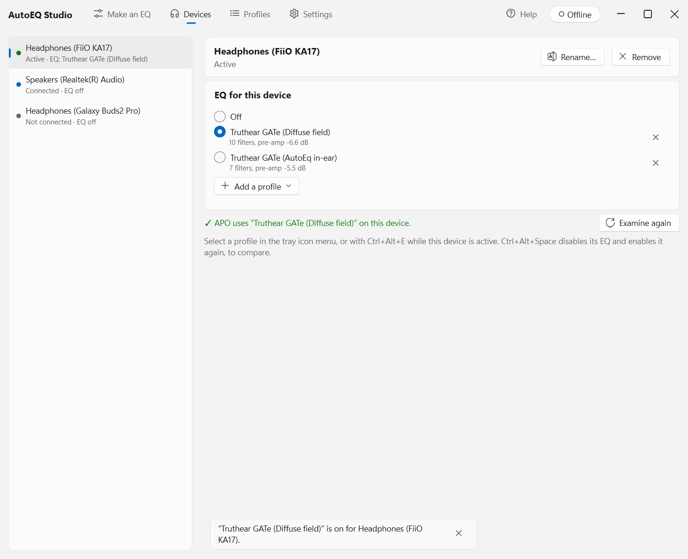

# AutoEQ Studio

AutoEQ Studio is a Windows app that makes EQs for headphones and IEMs. It also gives each playback device on your
PC its EQ.

- **Make an EQ.** The app compares a measurement of your headphones or IEMs with a target curve (the sound that you
  want). Then it finds the filters that make the measurement the same as the target. It saves the filters in the
  file that is necessary for your EQ app, or it puts them directly on a device.
- **EQ for each device.** Each playback device has its EQ, and the app changes the EQ automatically. When you
  connect the dongle of your IEMs, their EQ is on. When you connect your Bluetooth earbuds, their EQ is on. Your
  speakers can have no EQ. This part operates through [Equalizer APO](https://sourceforge.net/projects/equalizerapo/),
  which applies the EQ to the sound.

It is a Windows desktop app (Python and Qt), not a website. It also operates without the internet.

## Functions

- **Best fit:** this method adds filters one at a time. It keeps the minimum number of filters for the same sound as
  the target. The same sound is a difference of 0.25 dB or less at all frequencies, as the ear hears it. The EQ
  stays in the limits of your EQ app (number of filters, Q, gain, frequency range). The app also has Website AutoEQ,
  the AutoEQ method of the squig.link websites.
- **Measurements and targets:** you can use your files. You can also search the online measurement databases
  (squig.link websites, AutoEq) and the files on your PC. The app compares more than one measurement of the same
  model. It changes targets for a different measurement rig (711 coupler, B&K 5128).
- **Target adjustments:** tilt, bass, treble, ear gain and other adjustments. The graph shows each change when you make
  it.
- **Manual EQs:** you can start with an empty EQ, an EQ file (Equalizer APO, Room EQ Wizard, Peace), pasted filters
  or the profile of a device. The app reads them as Equalizer APO plays them. You can drag each filter on the EQ graph
  (frequency and gain), and the mouse wheel changes its Q. When you use an EQ for 5 minutes on a device, the device
  plays each change while you edit.
- **Saved files for 34 EQ apps and devices**, each in the limits of that app: Equalizer APO, Peace, foobar2000, Roon,
  Wavelet, Poweramp, USB Audio Player PRO, Qudelix, FiiO, miniDSP, EasyEffects and other apps. The app also makes an
  HTML report.
- **Listen:** you hear the EQ through your headphones, at the same level. You can hide the names, or do an ABX test.
  In each trial, X is A or B at random. At the end, the app shows your result, and how frequently random selections get the same result or a better
  result.
- **Graph tracer:** this tool changes a picture of a frequency response graph (for example, a data sheet or a
  screenshot from a website) into a measurement. It reads the axes with the text reader of Windows. Some databases
  do not let other programs download their files. For their entries, the app opens the website in your browser. Then
  it automatically traces a picture of the graph that you copy.
- **Devices and the tray:** profiles for each device, a tray icon, a hotkey, notifications, and a test that shows if
  Equalizer APO uses the EQ. The on/off hotkey disables the EQ of the active device and enables it again, to compare.
  “Off” has the same loudness as the EQ: only the sound is different. You can also update a profile with a new EQ.
  The devices that have the profile on use the new EQ, and Undo is available. You can remove a device that is not
  connected from Devices.
- **Help in the app:** the Guide with demos, and Help for each setting and each name in the app (F1 on a
  control). You can also use the app with a keyboard and with a screen reader.
- **The colors, text and symbols of Windows 11:** light or dark, as in Windows, in your Windows accent color,
  with Mica behind the window. On Windows 10, the app has the same colors, without Mica.

## Screenshots

  
  

## Necessary software

- Windows 10 or 11, 64-bit
- [Equalizer APO](https://sourceforge.net/projects/equalizerapo/) for the EQ of each device (Make an EQ operates
  without it)
- To start the app from the source code: 64-bit [Python](https://www.python.org/downloads/) 3.10 or a newer version

## Install the app

1. Download `AutoEQ Studio Setup <version>.exe` from [the newest version on GitHub](https://github.com/OscarBazylewich/AutoEQ-Studio/releases/latest).
2. Start the file.

The installer installs the app for your Windows account only (an administrator password is not necessary). The app
contains its Python. Other items are not necessary. The installer does not have a digital signature.
Thus, Windows can show "Windows protected your PC". If Windows shows this message, click **More info**. Then
click **Run anyway**.

To update the app, start the Setup file of a newer version. The installer keeps your files and settings.

## Start the app from the source code

1. Download this repository (**Code** > **Download ZIP**). Unzip the file. You can also clone the repository.
2. Double-click `AutoEQ Studio.bat`. At the first start, the app installs its Python packages (Qt, numpy, scipy
   and other packages, approximately 150 MB) in a `.venv` folder. After that, the app opens quickly.
3. On Make an EQ, click **Guide** (at the top right) to start the Guide. **Help** has data about all settings.

To use the EQ for each device, install Equalizer APO on your devices. Then click **Add AutoEQ Studio to APO…** in
the app.

**Make an installer:** `Make installer.bat` makes `releases\AutoEQ Studio Setup <version>.exe`, a usual Windows
installer that contains its Python. You must install [Inno Setup 6](https://jrsoftware.org/isinfo.php)
(`winget install JRSoftware.InnoSetup --scope user`).

[README.txt](README.txt) has the full instructions for all screens and settings.

## Your files

The app keeps your targets, measurements, saved EQs and presets in `Documents\AutoEQ Studio`. You can select a
different folder in Settings > Your files. The app keeps the settings and History in its `data` folder, or in
AppData if you installed the app. This repository does not contain your data.

## Tests and code

- The tests are in `tests\` ([pytest](https://pytest.org)), with a folder for each part of the app. Each test uses
  temporary folders, a test Equalizer APO folder and a temporary copy of the app. The tests do not change your files
  and settings, Equalizer APO or the registry, and they do not connect to the internet. First, install the
  test tools (pytest, and [Ruff](https://docs.astral.sh/ruff/), the linter that the tests use):
  `.venv\Scripts\python.exe -m pip install -r app\requirements-dev.txt`
- All tests, each part in a different process, with a short report: `.venv\Scripts\python.exe app\tools\selftest.py`
  (some minutes). With `--quick`, it does not do the tests of Make an EQ's screen and the long Best fit tests.
- Only the tests that are necessary for your changes: `.venv\Scripts\python.exe app\tools\relevant_tests.py --run --quick`.
  One file: `.venv\Scripts\python.exe -m pytest tests\ui\test_theme.py`.
- GitHub does the same tests on Windows for each push to `main` and each pull request (`.github\workflows\tests.yml`).
- Each module starts with a text about its function.

## Code and data from other sources

- [AutoEq](https://github.com/jaakkopasanen/AutoEq) by Jaakko Pasanen: the parametric EQ code in `app/eq/vendor/autoeq`
  (MIT) and the targets in `samples`.
- [squig.link](https://squig.link) and its graph tool: the AutoEQ method in `app/eq/vendor/squiglink` (0BSD) and the
  measurement databases.
- [Equalizer APO](https://sourceforge.net/projects/equalizerapo/), which applies the EQ to each device.

## License

[MIT](LICENSE). The files in `app/eq/vendor` have their licenses in the same folders.
